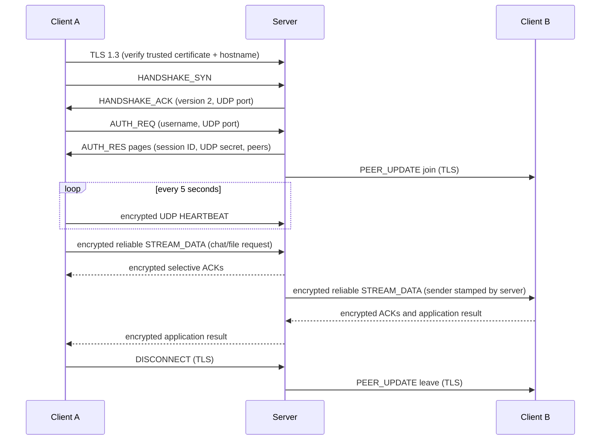

# Collaboration protocol v2

This specification describes the implemented backend, not the earlier plaintext
prototype. v2 peers require TLS and encrypted UDP; plaintext peers cannot join
an operational session. All multibyte binary integers use network byte order.

## Architecture and state



Connection states: TLS_HANDSHAKE -> READY_FOR_SYN -> READY_FOR_AUTH -> ACTIVE ->
CLOSED. Repeated handshake or unsupported control packets close the connection.
AUTH before handshake, duplicate online username, malformed auth data or a second
login are rejected with a failed AUTH_RES. A failed login may retry within the
login deadline. Only the socket owning a session may remove its registry entry.

One TCP worker writes all control packets for a connection. Peer updates queue
under the registry lock, keeping join/leave ordering consistent with the initial
snapshot. Queue overflow disconnects a slow peer instead of losing state silently.
Socket readers handle framing/crypto/ACKs. Application readers correlate results;
separate workers route requests or write file blocks. Congestion state is shared
across streams within one direction of one session, not across different clients.

## Packet header

Header format: Python `!BBHIIHHII`, 24 bytes.

| Offset | Bytes | Field | Meaning |
| --- | --- | --- | --- |
| 0 | 1 | msg_type | Packet type |
| 1 | 1 | flags | EOM=1, ACK=2, ENC=4, BRD=8, NACK=16 |
| 2 | 2 | stream_id | 0 for control, 1..65535 for reliable messages |
| 4 | 4 | seq_num | Chunk index in a stream; handshake request sequence |
| 8 | 4 | ack_num | Exact acknowledged chunk index; handshake seq+1 modulo 2^32 |
| 12 | 2 | win_size | Receive sequence-window width in packets |
| 14 | 2 | payload_len | Wire payload length, at most 1376 bytes |
| 16 | 4 | timestamp | Unix milliseconds modulo 2^32; informational |
| 20 | 4 | checksum | CRC32 of header with checksum=0 plus wire payload |

Total custom datagram length is at most 1400 bytes (IP/UDP headers excluded).
CRC detects accidental corruption; it is not an authentication primitive. GCM
also authenticates all header fields except the CRC value. TCP frames are exactly
header + payload_len bytes; oversized lengths are rejected before reading bodies.
Unknown types/flag bits, truncation, extra UDP bytes and invalid CRC are rejected.

### Types and transport

| Type | Value | Transport / flags |
| --- | --- | --- |
| HANDSHAKE_SYN | 0x01 | TLS TCP, EOM |
| HANDSHAKE_ACK | 0x02 | TLS TCP, ACK + EOM |
| AUTH_REQ | 0x10 | TLS TCP, EOM |
| AUTH_RES | 0x11 | TLS TCP, ACK; EOM only on final page |
| HEARTBEAT | 0x20 | Encrypted UDP, ENC + EOM |
| PEER_UPDATE | 0x21 | TLS TCP, EOM |
| ACK | 0x50 | Encrypted UDP, ENC + ACK |
| STREAM_DATA | 0x60 | Encrypted UDP, ENC; EOM on last chunk |
| DISCONNECT | 0xFF | TLS TCP, EOM, empty payload |

MSG_UNICAST/BROADCAST (0x30/31), FILE_INIT/CHUNK (0x40/41), NACK (0x51),
and BRD/NACK flags are reserved, not dispatched as application traffic. Chat and
files use application operations within STREAM_DATA. TLS protects TCP packets;
their application headers do not set ENC.

## TLS bootstrap and key lifecycle

1. The client establishes TLS >=1.3 and verifies the configured trust anchor and
   server IP/DNS identity. There is no plaintext downgrade or trust-all mode.
2. SYN has an empty payload. ACK JSON is `{status: "READY", server_udp_port, version: 2}`.
3. AUTH_REQ JSON is `{username, udp_port}`. Username: 1..32 Unicode alphanumeric
   characters or `_-.`, case-sensitive. UDP port: integer 1..65535, not boolean.
4. The server generates independent 32-byte random `session_id` and `udp_secret`.
   Success AUTH_RES JSON: `{version: 2, success: true, session_id, udp_secret, peers}`.
   ID and secret are hex strings. Peers are `{user, ip, udp_port}` entries.
   Large snapshots span multiple bounded packets; key material and ACK are the
   same on every page. Failure: `{success: false, error}` in one final packet.
5. Session ID is a public routing identifier. `udp_secret` is never sent outside
   TLS or to another client. File routing uses a separate public generation ID
   so transfers can be tied to sender sessions without sharing key material.
6. A fresh secret is generated on every login/reconnect. Keys expire after one
   hour or 2^32 transmitted datagrams per direction, whichever happens first.
   Reconnect is explicit; there is no live TCP session resumption in the app.
7. On close, cipher objects discard key caches and master-secret references.
   Python/cryptography cannot promise physical memory erasure. Never log AUTH
   payloads, secrets or private keys. Old-session packets cannot authenticate
   under a new session's secret, even if a username or UDP endpoint is reused.

TLS uses a self-signed, locally provisioned ECDSA P-256 server identity by default.
Clients must receive its certificate through a trusted channel. The certificate
is public; the private key stays on the server, outside source control. Rotation
requires a new identity, client trust update and server restart. Certificate trust
authenticates the server only; username registration is not user authentication.
The trusted server can read relayed data (hop-by-hop rather than end-to-end).

### Encrypted UDP envelope

Wire payload:

```
32-byte public session ID | uint64 counter | ciphertext | 16-byte GCM tag
```

AES-256-GCM overhead is 56 bytes. The server selects a session by public ID and
registered source IP/port, then authenticates before interpreting any plaintext.
Client likewise checks the server endpoint before opening the packet.

For each direction, counter starts at 0, increments for **every** seal attempt
(including retries/ACKs/heartbeats), never resets, and must be less than 2^32.
`epoch = counter // 65536`. Direction labels are ASCII `c2s` and `s2c`.

```
material = HKDF-SHA256(
  input_key_material = udp_secret,
  salt = session_id,
  info = b"collab-v2-udp-" || direction || uint64(epoch),
  length = 36)
key = material[0:32]
nonce = material[32:36] || uint64(counter)
AAD = wire_header_with_crc_zero || session_id || uint64(counter)
```

Epoch changes rotate traffic keys independently in each direction without a
rekey control message. Counters carry the epoch implicitly. At most six derived
keys are cached; a key may be rederived for valid reordered packets. Epoch keys
are derived from the session master: rotation is not post-compromise security.

Each receiving direction maintains an authenticated sliding replay bitmap of
4096 counters. Reordered unseen counters within this window are accepted; exact
duplicates and older counters are dropped. Invalid tags do not advance the bitmap.
A retransmitted reliable chunk gets a fresh counter/tag, allowing a receiver to
ACK it again without permitting encrypted-datagram replay. Reflection attacks
fail because c2s/s2c keys differ. No unauthenticated UDP updates liveness or ACK state.

## Reliable streams and congestion control

After decryption, DATA payload is:

```
32-byte session ID | uint32 total_chunks | 0..1284 chunk bytes
```

Non-final chunks have exactly 1284 bytes. Empty messages use one empty final
chunk. `seq_num` starts at zero per stream and EOM agrees with `total_chunks-1`.
ACK plaintext is exactly the 32-byte session ID. Its `ack_num` identifies one
chunk, not a cumulative ACK. ACKs for unsent chunks are ignored.

The sender maintains per-stream first-unacknowledged sequence, next sequence,
pending chunks, acknowledged holes, retry count and completion receipt. It never
sends outside `base + min(local_window, advertised_receive_window)`. The receiver
stores bounded out-of-order chunks and delivers a complete message once all are
present. A full application delivery queue withholds the completing chunk's ACK.
Completed stream IDs remain as tombstones until session close: late retransmits
get ACKed without redelivery. Incomplete streams expire after 30 seconds without
received chunks. IDs increase per direction, never wrap/reuse within the session;
reconnect after 65,535 sends. Default limits: 8 MiB/message, 16 active streams per
direction, 16 completed messages queued. Application file blocks are only 256 KiB.

`congestion.py` implements a CUBIC-style controller in packet units:

- Shared cwnd across all sending streams, initially min(4, receive window),
  maximum 256. Initial slow-start threshold is 32. Round-robin scheduling avoids
  allocating the entire budget to the first stream.
- Slow start grows by one packet per valid new ACK. Avoidance uses C=0.4,
  beta=0.7, cubic target `C*(t+RTT-K)^3 + W_max`, with
  `K=((W_max-cwnd_at_epoch_start)/C)^(1/3)`, and a Reno-friendly target.
  Per-ACK growth is capped at one packet.
- An RTO reduces cwnd to 1 and threshold to max(2, previous_cwnd*0.7), records
  W_max (fast convergence when below the previous maximum), and resets the epoch.
  Losses in the same recovery interval do not repeatedly reduce the window.
- Token-bucket pacing is replenished at cwnd/max(SRTT,10 ms), default RTT 100 ms,
  with a burst cap of cwnd. Both new sends and retransmissions consume tokens;
  ACK/control packets are exempt. New data waits until aggregate in-flight
  packets across streams are below cwnd, in addition to stream flow control.
- RTT uses first-send ACKs only (Karn). SRTT alpha=1/8, RTTVAR beta=1/4,
  RTO=SRTT+4*RTTVAR, bounded to 100 ms..3 s (initial 250 ms).
  Retry deadline is min(3 s, RTO*2^min(retries,4)). Selective retransmission only
  resends unacknowledged chunks. Limit: 12 retries or 30 seconds without progress.

This implements the CUBIC growth/decrease core for custom UDP, not all TCP CUBIC
requirements. ECN, HyStart++, fast retransmit/SACK recovery and spurious-loss
undo are absent. No production throughput/fairness claim is made from localhost
tests. A transfer receipt confirms receiver transport acceptance, not user action;
a lost final ACK can leave sender status uncertain.

## Application framing, chat and files

A complete stream contains `b"COLLAB1\0" || uint32(json_length) || JSON || body`.
JSON length <=8192 bytes. Fields: `kind` (request/result), UUID hex `id`, and `op`
for requests. A result contains `ok` and `result` or `error`. Request IDs correlate
application outcomes independently of stream IDs. RPC reader threads demultiplex
results so request workers never block the packet/heartbeat loop. Raw low-level
streams must not start with the reserved magic. Raw queues must be drained.

| Operation | Header fields | Body / semantics |
| --- | --- | --- |
| chat | to: username or null | 1..65536 UTF-8 bytes; null broadcasts to other current peers |
| file_begin | to, file_id, name, size | Empty; reserve receiver temp file |
| file_block | to, file_id, offset | 1..262144 bytes; exact next offset |
| file_end | to, file_id, sha256 | Empty; verify byte count/hash, publish |
| file_abort | to, file_id | Empty; remove partial state/file |

Server injects `sender` from the authenticated connection; caller-provided sender
values are not trusted. Chat result lists delivered and failed recipients; delivery
means accepted into the recipient's bounded inbox. A file route is pinned to its
receiving session, not just username. Sender generation IDs prevent new sessions
from continuing an old transfer. Server relays without storing entire files.

Sender waits for each application file-block acknowledgement before advancing,
so stream independence cannot reorder file stages. Receiver incrementally writes
and hashes bytes in a private `.part-*` file. On end, size and SHA-256 must match;
flush/fsync/close precede atomic no-overwrite publication via same-filesystem hard
link. Final name is `<file_id>_<safe_original_name>`. Names with traversal, separators,
reserved device names or invalid characters are rejected. Hard-link support is
required. Max file size 1 GiB, eight active incoming files, 32 file events queued.

Malformed blocks/hash, abort, sender leave or session shutdown remove partial
files; idle partial state expires after 60 seconds. An application timeout (default
15 seconds/request) does not cancel a delivered operation or prove non-delivery.
No automatic resume or application-level retry is performed; resending uses a new ID.

## References

- [Python TLS/SSL sockets](https://docs.python.org/3/library/ssl.html)
- [PyCA authenticated encryption](https://cryptography.io/en/latest/hazmat/primitives/aead/)
- [RFC 9438 CUBIC](https://www.rfc-editor.org/rfc/rfc9438.html)
- [RFC 6298 retransmission timer](https://www.rfc-editor.org/rfc/rfc6298.html)
